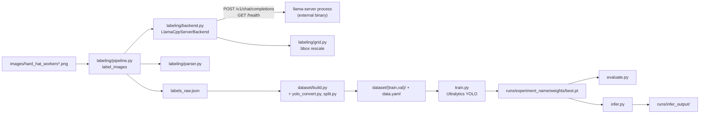

# Zero-Annotation-OD (`zeod`) - documentation hub

`zeod` is a Python command-line pipeline that trains a two-class object detector
(`helmet` / `no_helmet`) from a folder of unlabeled photos. A local
vision-language model (Qwen2.5-VL served by llama.cpp's `llama-server`) writes
the bounding boxes, the boxes are converted into a YOLO dataset, and a YOLOv8
model is fine-tuned and evaluated on it (`src/zeod/cli.py`, `../README.md`).
The project began as a Yandex Practicum computer-vision capstone (`../README.md`, "Why this exists"; brief in `task.txt`);
who uses it beyond that is not stated in the repository.

This page indexes the documentation and records what was checked against the code.
The requirements are in [`../SPEC.md`](../SPEC.md).

## Status

| Item | State | Source |
| --- | --- | --- |
| Last commit on `dev` | `52ceef6`, 2026-08-06 07:38 +0300, "docs: put the benchmark numbers in the README" | `git log -1` |
| History | 7 commits on `dev`, first on 2026-07-06 | `git log` |
| Package version | `0.2.0` | `pyproject.toml:7`, `src/zeod/__init__.py` |
| Tags | `v1.0.0` (`d1b29ca`), `v1.1.0` (`f708fc2`, on `release` only), `import/dev` (`52ceef6`) | `git tag` |
| Unit tests | 60 tests in `tests/`; 60 passed in a local run (see "About this document") | `tests/` |
| Benchmarks | 9 cases in `benchmarks/test_labeling_performance.py` (needs `pytest-benchmark`) | that file |
| CI | `python-ci.yml`: ruff lint, ruff format check, pytest with coverage, gitleaks, branch policy; `release.yml`: build on `v*.*.*` tags | `.github/workflows/` |
| TODO / FIXME / XXX / HACK | 0 outside `legacy/` | `git grep -w` |

Other branches: `origin/release` and `origin/test` have 22 commits that are
not on `dev` (the latest dated 2026-11-08, tag `v1.1.0`). Among other changes
they add `CLAUDE.md`, `recipe.ps1`, `uv.lock`, `docs/install.md`,
`docs/manual.md` and `tests/manual/`, and they delete `docs/task.txt` and
`coverage.xml` (`git diff --stat origin/dev origin/release`). This page and
`SPEC.md` describe `dev` at `52ceef6` only.

What is evidently unfinished on `dev`:

- `docs/architecture.md` names `label_images` (cyclomatic complexity 16) as "the obvious next refactor".
- `scripts/profile_application.py` and `scripts/capture_usage_screenshots.py` target a package
  `quality_template` and a "Text Analyser" window, and neither exists in this repository. Running the profiler
  fails with `ModuleNotFoundError: No module named 'quality_template'` (checked).
- `scripts/install_dependencies.py --from-lock` needs `requirements-dev.lock`, which is not in the repository
  (`scripts/install_dependencies.py:21,86-89`).
- Several statements in `CONTRIBUTING.md`, `SECURITY.md`, `docs/branching.md` and `docs/quality-iso25010.md`
  do not match the code (listed under "Known limitations and problems").

## Layout

| Path | What it is |
| --- | --- |
| `src/zeod/cli.py` | Entry point `zeod`: subcommands `label`, `build-dataset`, `train`, `evaluate`, `infer`, `pipeline` |
| `src/zeod/config.py` | Pydantic models for the YAML config; `--set key.path=value` overrides |
| `src/zeod/labeling/backend.py` | `VLMBackend` interface, `LlamaCppServerBackend` (subprocess + HTTP), `MockBackend` for tests |
| `src/zeod/labeling/grid.py` | `smart_resize` and `rescale_bbox_to_pixels`: map Qwen-VL grid coordinates back to image pixels |
| `src/zeod/labeling/parser.py` | `parse_json_response`: pull a JSON array of detections out of free-form model text |
| `src/zeod/labeling/pipeline.py` | `label_images`: resume, checkpoints, restart of the backend after repeated failures |
| `src/zeod/dataset/yolo_convert.py` | Pixel boxes to YOLO lines: label filter, IoU dedup, clamping, head crop, size filter |
| `src/zeod/dataset/split.py` | Seeded train/val split |
| `src/zeod/dataset/build.py` | Writes `dataset/{train,val}/{images,labels}` and `data.yaml` |
| `src/zeod/train.py`, `evaluate.py`, `infer.py` | YOLOv8 fine-tuning, validation metrics and FP/FN mining, inference (Ultralytics) |
| `src/zeod/device.py` | `"auto"` -> CUDA device `0` or `"cpu"` |
| `src/zeod/logging_setup.py` | Root logger to stdout, `HH:MM:SS [LEVEL] name: message` |
| `configs/default.yaml` | All paths, prompts, model and quantisation, thresholds, hyperparameters |
| `tests/` | 60 GPU-free, network-free pytest tests |
| `benchmarks/` | pytest-benchmark cases for parsing, dedup, `smart_resize`, split |
| `notebooks/eda_and_error_analysis.ipynb` | EDA and error analysis; imports from `src/zeod` |
| `scripts/` | Pre-push check, branch policy, release build, dependency install, quality metrics; two template leftovers (see "Status") |
| `.github/workflows/` | `python-ci.yml`, `release.yml` |
| `docs/` | This page, architecture, branching, ISO 25010 assessment, course brief, VM note, README images |
| `legacy/` | Original vLLM script and notebooks; an unrelated C++/Qt agent-scaffolding template |
| `coverage.xml` | Committed coverage report showing `lines-covered="0"` (a generated file) |

## Architecture

The stages exchange files on disk, not Python objects: `label` writes
`labels_raw.json`, `build-dataset` reads it and writes `dataset/`, `train` reads
`dataset/data.yaml` and writes `runs/<experiment_name>/weights/best.pt`, and
`evaluate` and `infer` read those weights (`src/zeod/cli.py:36-137`,
`docs/architecture.md`). Every stage takes its paths and thresholds from
`AppConfig` (`src/zeod/config.py:112-125`).



External software and services:

- `llama-server` from llama.cpp is started as a subprocess on `127.0.0.1:8090` by default
  (`src/zeod/labeling/backend.py:79-123`, `configs/default.yaml:40-58`). With `hf_repo` set, it is
  started with `-hf <repo>:<quant>` (`backend.py:101`); according to `../README.md`, llama-server then downloads
  and caches the model and the mmproj file on first run.
- Ultralytics YOLO for training, validation and prediction (`train.py`, `evaluate.py`, `infer.py`).
- PyTorch, imported only to check `torch.cuda.is_available()` (`device.py:19-22`). It is not listed directly in
  `pyproject.toml`; CI installs it explicitly (`python-ci.yml:31`).
- GPU: optional. `device: auto` uses CUDA device 0 when available, otherwise CPU (`device.py:10-24`).

## Build and run

Prerequisites:

| Requirement | Version / value | Source |
| --- | --- | --- |
| Python | `>=3.10,<3.14`; CI uses 3.12 | `pyproject.toml:10`, `python-ci.yml:27` |
| Runtime libraries | ultralytics 8.3-8.x, pydantic 2.x (>=2.7), pyyaml 6.x, requests 2.x (>=2.31), numpy >=1.26,<3, pillow >=10,<12, tqdm 4.x (>=4.66) | `pyproject.toml:14-20` |
| llama.cpp `llama-server` binary | on `PATH`, or `llama_cpp.server_binary` set to its full path | `configs/default.yaml:41`, `../README.md` |
| Input images | `images/hard_hat_workers*.png` (not in the repository; `/images/` is git-ignored) | `configs/default.yaml:7-8`, `.gitignore` |

Install (Windows PowerShell, from `../README.md`, "Installation (Windows)"):

```powershell
py -3.13 -m venv .venv
.\.venv\Scripts\Activate.ps1
pip install -e ".[dev]"
# GPU only, last step (README pins this pair for an RTX 3060 Ti):
pip install torch==2.6.0 torchvision==0.21.0 --index-url https://download.pytorch.org/whl/cu124 --force-reinstall --no-deps
```

Alternative: `python scripts/install_dependencies.py --dev` runs `pip install --upgrade pip` and
`pip install -e ".[dev]"` (`scripts/install_dependencies.py:94-95`).

CI's install order (`.github/workflows/python-ci.yml:31-34`):

```bash
pip install torch --index-url https://download.pytorch.org/whl/cpu
pip install -e ".[dev]"
```

Run: `zeod <subcommand>` (console script, `pyproject.toml:34`) or `python -m zeod.cli <subcommand>`
(`../README.md`, "Usage"). Release build: `python scripts/build_release_artifact.py --version vX.Y.Z` writes a
PyInstaller one-file executable, a zip and `.sha256` files to `release/` (`scripts/build_release_artifact.py`,
`release.yml:39`).

## Configuration

There are no environment variables in `src/` (`git grep os.environ|getenv`). Configuration comes from one YAML file
plus command-line overrides:

- `--config PATH` - YAML file; default `configs/default.yaml` under the project root, which is derived from the
  location of `src/zeod/config.py` (`src/zeod/config.py:11-12`, `cli.py:148`).
- `--set key.path=value` - repeatable. It must come before the subcommand. Values become int, then float, then
  `true`/`false`, then `null`/`none`, otherwise a string (`config.py:128-145`, `cli.py:141-155`).

| Key | Default | Meaning | Source |
| --- | --- | --- | --- |
| `seed` | `42` | Seeds `random`, `numpy`, the split and YOLO training | `configs/default.yaml:4`, `cli.py:23-25` |
| `paths.images_dir` / `paths.image_glob` | `images` / `hard_hat_workers*.png` | Input photos | `default.yaml:7-8` |
| `paths.labels_raw_path` | `labels_raw.json` | Output of `label` | `default.yaml:9` |
| `paths.dataset_dir` / `paths.runs_dir` | `dataset` / `runs` | YOLO dataset; Ultralytics project dir | `default.yaml:10-11` |
| `labeling.class_map` | `helmet: 0`, `no_helmet: 1` | Label name to YOLO class id | `default.yaml:14-16` |
| `labeling.system_prompt`, `labeling.user_prompt` | text in YAML | Prompts sent with each image; required, no code default | `default.yaml:17-31`, `config.py:23-29` |
| `labeling.temperature` / `max_tokens` | `0.1` / `512` | Sampling settings sent to the server | `default.yaml:32-33` |
| `labeling.checkpoint_every` | `20` | Save `labels_raw.json` every N images | `default.yaml:34` |
| `llama_cpp.server_binary` | `llama-server` | Executable name or path | `default.yaml:41` |
| `llama_cpp.host` / `port` | `127.0.0.1` / `8090` | Server address | `default.yaml:42-43` |
| `llama_cpp.hf_repo` / `hf_quant` | `ggml-org/Qwen2.5-VL-3B-Instruct-GGUF` / `Q4_K_M` | Passed as `-hf repo:quant` | `default.yaml:46-47`, `backend.py:100-101` |
| `llama_cpp.model_path` / `mmproj_path` | `null` | Local GGUF files; take precedence over `hf_repo` | `default.yaml:49-50`, `backend.py:96-99` |
| `llama_cpp.n_gpu_layers` | `-1` | `--n-gpu-layers`; `0` = CPU only | `default.yaml:51` |
| `llama_cpp.ctx_size` | `4096` | `--ctx-size` | `default.yaml:52` |
| `llama_cpp.image_min_tokens` | `1024` | `--image-min-tokens`; also used for bbox rescaling | `default.yaml:55`, `config.py:64-68` |
| `llama_cpp.image_max_tokens` | `null` (code uses 16384) | Only for bbox rescaling; not sent to the server | `config.py:55`, `grid.py:27` |
| `llama_cpp.n_parallel` | `1` (code only) | `--parallel` | `config.py:48`, `backend.py:93-94` |
| `llama_cpp.startup_timeout_s` / `request_timeout_s` | `240` / `120` | Wait for `/health`; per-request HTTP timeout | `default.yaml:56-57` |
| `llama_cpp.extra_server_args` | `[]` | Appended to the server command line | `default.yaml:58`, `backend.py:104` |
| `dataset.val_split` | `0.2` | Fraction for validation; must be in (0, 1) | `default.yaml:61`, `split.py:18-19` |
| `dataset.min_box_frac` / `max_box_frac` | `0.005` / `0.95` | Keep boxes whose normalised w and h lie strictly between these | `default.yaml:62-63`, `yolo_convert.py:116` |
| `dataset.dedup_iou_threshold` | `0.9` | Drop later same-label boxes with IoU above it; `null` disables | `default.yaml:65` |
| `dataset.head_crop_max_aspect_ratio` | `1.8` | Crop boxes with h/w above it to a top-anchored square; `null` disables | `default.yaml:69` |
| `train.base_weights`, `epochs`, `imgsz`, `batch`, `patience` | `yolov8n.pt`, `50`, `640`, `16`, `10` | `base_weights` to `YOLO(...)`, the rest to `model.train` | `default.yaml:72-76`, `train.py:26-38` |
| `train.device` / `evaluate.device` | `auto` | `auto`, `cpu`, or an Ultralytics device string | `default.yaml:77,83` |
| `train.experiment_name` | `helmet_detection` | Run directory name under `runs/` | `default.yaml:78` |
| `evaluate.conf` | `0.25` | Confidence for FP/FN mining (not for mAP) | `default.yaml:81`, `evaluate.py:34-39` |
| `evaluate.iou` | `0.5` | IoU passed to `model.val` | `default.yaml:82` |
| `evaluate.fp_fn_examples` | `4` | Examples per FP / FN list | `default.yaml:84` |

## Usage

Commands from `../README.md`, "Usage", "Smoke test" and "Configuration":

```powershell
python -m zeod.cli label --limit 10                 # label the first 10 images (sorted by path)
python -m zeod.cli label                            # label the rest; already-labeled images are skipped
python -m zeod.cli build-dataset                    # labels_raw.json -> dataset/ ; prints stats as JSON
python -m zeod.cli train                            # fine-tune YOLOv8n
python -m zeod.cli evaluate --analyze-errors        # mAP50, mAP50-95, precision, recall + FP/FN lists as JSON
python -m zeod.cli infer "images/hard_hat_workers9*.png" --output runs/infer_output
python -m zeod.cli pipeline --limit 15              # label -> build-dataset -> train -> evaluate
python -m zeod.cli --set train.epochs=100 --set train.batch=8 train
python -m zeod.cli --set llama_cpp.hf_quant=Q8_0 label
```

Exit codes: `0` on success; `1` when the config cannot be loaded or a stage raises `FileNotFoundError`,
`ValueError`, `TimeoutError` or `RuntimeError` (`cli.py:187-205`); `2` for argparse usage errors. Checked
locally: `build-dataset` without `labels_raw.json` and `label` without `images/` both log the cause and exit 1;
`--set` placed after the subcommand gives `unrecognized arguments` and exit 2.

## Testing

```bash
pytest                                  # tests/ only (pyproject.toml:39-40)
pytest --cov=src/zeod --cov-report=xml  # as in CI (python-ci.yml:43)
pytest benchmarks --benchmark-only      # benchmarks (benchmarks/test_labeling_performance.py docstring)
python scripts/check_before_push.py     # runs the ruff/pytest commands found in .github/workflows
python scripts/collect_quality_metrics.py --output quality-report.json
```

What the tests cover: YOLO conversion, clamping, dedup and head crop (`test_yolo_convert.py`, 16); response
parsing (`test_parser.py`, 13); grid rescaling (`test_grid.py`, 7); split determinism and validation
(`test_split.py`, 10); config loading and overrides (`test_config.py`, 6); dataset layout and `data.yaml`
(`test_dataset_validity.py`, 3); labeling with `MockBackend`: resume, error retry, label-then-build smoke test,
and restart after 3 failures with a stub backend (`test_pipeline_smoke.py`, 5). `test_set_override_bool` overrides
an int (`n_gpu_layers=-1`), so bool coercion of `--set` is untested.

Not covered by any test: `LlamaCppServerBackend` (process start, `/health` polling, HTTP request, shutdown), the
bbox rescaler hook inside `label_images`, `cli.py`, `train.py`, `evaluate.py`, `infer.py`, `device.py`.
Model quality is not asserted anywhere (`quality-iso25010.md`, section 1).

## Known limitations and problems

Checked by running:

1. `--set train.device=0` (and `evaluate.device=0`) is rejected: the override turns `0` into an int, and the
   `str` field fails pydantic validation, so the CLI exits 1 (pydantic 2.11.5; `config.py:135-145`,
   `config.py:101,108`). The YAML comment `auto | cpu | 0 | 0,1` (`default.yaml:77`) suggests `0` is valid.
   `0,1` and `cpu` pass. By YAML rules an unquoted `device: 0` in a config file is also an int and would fail the
   same way, while a quoted `"0"` stays a string. Neither YAML case was run.
2. `scripts/profile_application.py` fails on import (`quality_template` does not exist). By the same reading of
   the code, `scripts/capture_usage_screenshots.py` launches `quality_template.cli` (lines 131, 173); it was not run.

Read from the code, not run:

3. After 3 consecutive failures the backend is restarted and only the current image is retried. The images that
   failed before it keep an `error` field and are retried on the next `label` run. The threshold of 3 is a function
   parameter that neither the CLI nor the YAML exposes (`pipeline.py:89,108,128-135`, `cli.py:48-58`).
4. `labels_raw.json` stores absolute image paths (`cli.py:29-30` with `config.py:11,123-125`). If the project
   moves, `build-dataset` skips every image with a warning (`build.py:51-53`).
5. `build-dataset` does not empty `dataset/` before writing (`build.py:81-89`). Inference: after the labels or
   filters change, files from an earlier split stay in place, and an image can end up in both `train/` and `val/`.
6. FP/FN mining compares box counts, not IoU matches (`evaluate.py:70-101` docstring).
7. `device: auto` never selects Apple MPS (`device.py:10-24`), although `architecture.md` and
   `quality-iso25010.md` say it picks "CUDA, MPS or CPU".
8. Inference, not verified: `llama-server` output goes to a pipe (`backend.py:108-114`) that is read only when the
   process has already exited (`backend.py:131`). If the server writes more than the OS pipe buffer holds, its
   writes could block. This matches the observed symptom of the server hanging after about a hundred requests
   (`config.py:42-48`; `../README.md` says "a few hundred"). The repository attributes that hang to slot scheduling instead.
9. Inference, not verified: the PyInstaller build adds no data files (`build_release_artifact.py:58-76`), and the
   zip holds only the executable, README, LICENSE and CHANGELOG (lines 92-95). The default config is located
   through `__file__` (`config.py:11-12`), so the frozen executable probably needs `--config`.
10. `release.yml` declares a `version` input for manual runs, but the build step uses `github.ref_name`
    (`release.yml:39`).
11. The notebook visualises labels through `build_valid_items` without the head-crop argument, which defaults to
    `None` (`build.py:38`). Its label plots therefore differ from what `build-dataset` writes with the default
    `1.8`.
12. With a custom `image_glob`, two images with the same stem collide in `labels_raw.json`, which is keyed by
    `Path.stem` (`pipeline.py:108,150`).
13. Network use: `-hf` downloads the model (per `../README.md`). Inference: Ultralytics fetches `yolov8n.pt` when it
    is absent. The labeling step talks only to `127.0.0.1` by default.

Documents that contradict the code (left unchanged here):

- `docs/branching.md` names `.github/workflows/branch-policy.yml` running "every Monday". No such file exists; the
  branch check is a job in `python-ci.yml:56-66` that runs on push and pull requests, with no schedule.
- `docs/quality-iso25010.md` says ruff `flake8-bandit` rules run and a scheduled secret scan exists. Ruff selects
  `E, F, I, UP, B` (`pyproject.toml:48`), and gitleaks runs on push and pull requests (`python-ci.yml:45-54`).
- `SECURITY.md` lists gitleaks and `detect-private-key` in pre-commit, ruff `S` rules, `requirements-dev.lock`
  and `ci.yml`. None of them are in `.pre-commit-config.yaml`, `pyproject.toml` or the repository.
- `CONTRIBUTING.md` describes a different repository (`repo-quality-template`, `core.py`, `app.py`,
  `fail_under`, ruff `C90`).
- `CHANGELOG.md` has a release `1.0.0`, while `pyproject.toml` says `0.2.0`. Tag `v1.1.0` has no changelog entry
  on `dev`.
- `../README.md` says `legacy/agent_scaffolding_cpp_qt/` was kept because "this repo has no git history"; `dev`
  has 7 commits. The README badges say "platform Windows" and "python 3.10-3.13". CI runs Ubuntu with
  Python 3.12 only, and `release.yml` builds on Windows and Ubuntu with 3.12.
- `.vscode/extensions.json` recommends C++/CMake extensions, and nothing in this repository uses them.

## Related documents

- [`../README.md`](../README.md) - project README: results, pipeline, model choice, install, usage, data-quality diagnosis
- [`../SPEC.md`](../SPEC.md) - requirements specification reverse-engineered from the code
- [`architecture.md`](architecture.md) - stages, dependency rule, the two functions that decide label quality
- [`quality-iso25010.md`](quality-iso25010.md) - ISO/IEC 25010 assessment with metrics from 2026-08-05
- [`branching.md`](branching.md) - `release` / `test` / `dev` branch policy and release steps
- [`task.txt`](task.txt) - course task brief (Russian)
- [`connect-to-vm.txt`](connect-to-vm.txt) - course note on the GPU VM used by the original vLLM version
- [`../CHANGELOG.md`](../CHANGELOG.md), [`../CONTRIBUTING.md`](../CONTRIBUTING.md), [`../SECURITY.md`](../SECURITY.md), [`../LICENSE`](../LICENSE) (MIT)
- [`../configs/default.yaml`](../configs/default.yaml), [`../notebooks/eda_and_error_analysis.ipynb`](../notebooks/eda_and_error_analysis.ipynb)

## About this document

Written on 2026-11-18 from commit `52ceef6` (`origin/dev`, local branch `docs/spec-and-docs`).

Commands run to check it, on Windows 10 with Python 3.13.3, pydantic 2.11.5 and pytest 9.1.1. Pytest 9 is
outside the `<9` pin in `pyproject.toml:25`. The package was not installed; `PYTHONPATH=src` was used instead,
and bytecode and the pytest cache were disabled:

- `git status`, `git log`, `git ls-files`, `git tag`, `git branch -a`, `git grep`, `git diff --stat origin/dev origin/release`
- `python -m pytest --collect-only -q -p no:cacheprovider` -> 60 tests collected
- `python -m pytest -q -p no:cacheprovider` -> 60 passed in 1.68 s
- `python -m zeod.cli --help`, `python -m zeod.cli infer --help`
- `python -m zeod.cli build-dataset` (no `labels_raw.json`) -> exit 1; `label --limit 1` (no `images/`) -> exit 1;
  `build-dataset --set x=1` -> exit 2; `--set badoverride build-dataset` and `--config nonexistent.yaml build-dataset` -> exit 1
- `load_config(overrides=["train.device=0"])` and similar -> `ValidationError` for `0`, accepted for `cpu` and `0,1`
- `python scripts/profile_application.py` -> `ModuleNotFoundError: No module named 'quality_template'`

Not run: `label` against a real `llama-server`, `train`, `evaluate`, `infer`, `pipeline` (Ultralytics is not
installed here, and there are no images or GPU run); `pytest benchmarks` (pytest-benchmark is not installed);
`ruff check` and `ruff format --check` (ruff is not installed); the release build; `check_before_push.py`;
`collect_quality_metrics.py`; the notebook; any CI workflow. The metrics and timings quoted in `../README.md`
were not reproduced.
